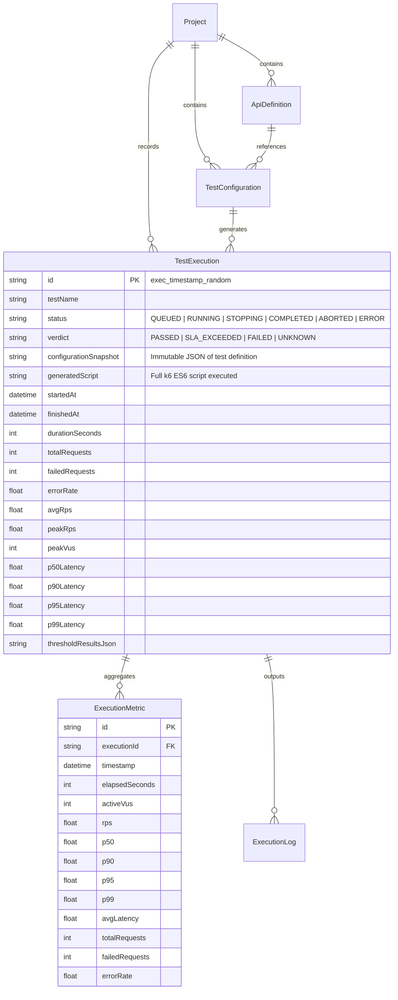
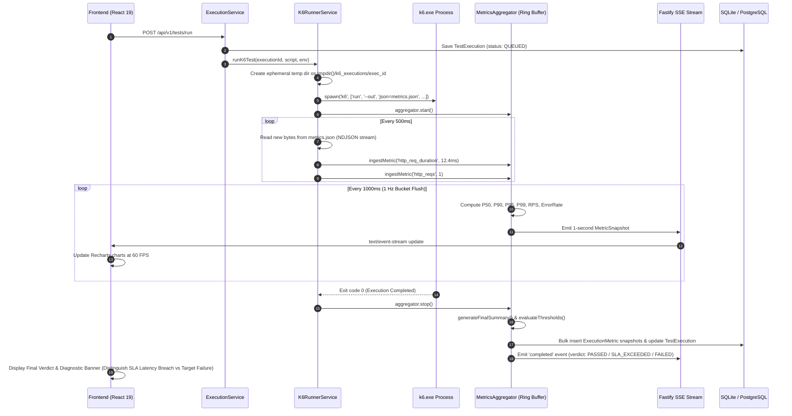

# SYSTEM DESIGN AND ARCHITECTURE SPECIFICATION
## Antigravity Dynamic API Load Testing Platform (k6 + Fastify)

> **Purpose of this document:**  
> This document provides an exhaustive, authoritative architectural and operational specification of the entire API Load Testing Platform. Any engineer or AI agent continuing work on this project should read this document first. It details every module, data model, security boundary, real-time pipeline, and execution workflow implemented in the system.

---

## 1. Executive Overview & Design Principles

The platform is a self-hosted, enterprise-grade API performance testing system. It bridges the gap between no-code load testing UI and the high-throughput, low-footprint power of **Grafana k6**, backed by a high-concurrency **Fastify v5** orchestration server.

### Key Architectural Tenets
1. **Zero-Code Load Testing for Users:** Users configure endpoints, methods, headers, auth, payloads, virtual users (VUs), duration, stages, and SLA thresholds through a visual dashboard. No manual JavaScript or k6 script creation is required.
2. **Immutable Execution Snapshots:** When an execution starts, the entire configuration is frozen into a self-contained snapshot inside the database. Subsequent modifications to the parent API definition or test configuration never alter running or historical tests.
3. **Sub-Second Streaming without Event-Loop Starvation:** High-volume load tests generate thousands of metric points per second. Streaming every individual raw metric freezes browser UI charts and saturates databases. The system employs an in-memory **1-second sliding-window ring buffer** that computes percentiles ($P_{50}, P_{90}, P_{95}, P_{99}$), RPS, and error rates, broadcasting updates **strictly at 1 Hz** via Server-Sent Events (SSE).
4. **Ironclad SSRF & Credential Protection:** Load testing platforms can inadvertently become DDoS weapons. All target URLs undergo DNS resolution and bogon/private IP filtering (blocking loopback `127.0.0.1`, RFC-1918 subnets, and cloud metadata `169.254.169.254`). All secrets are encrypted with **AES-256-GCM** and injected exclusively via process environment variables (`__ENV`), preventing credential leakage in script previews or logs.
5. **Dual-Runner Architecture (Native Host & Containerized):** The runner supports both direct execution via the host's native `k6.exe` binary (for zero-friction local development) and containerized execution via Docker Compose (for production cluster deployments).

---

## 2. Monorepo Project Structure

The project uses npm workspaces with strict TypeScript:

```
k6-load-testing/
│
├── apps/
│   ├── backend/                      # Fastify v5 Server & Process Orchestrator
│   │   ├── src/
│   │   │   ├── config/
│   │   │   │   └── env.ts            # Typed environment configs and safety limits
│   │   │   ├── db/
│   │   │   │   └── prisma.ts         # Prisma client singleton
│   │   │   ├── security/
│   │   │   │   ├── ssrf-validator.ts # DNS resolution & private CIDR blocking
│   │   │   │   ├── crypto-vault.ts   # AES-256-GCM encrypt/decrypt utilities
│   │   │   │   └── log-redactor.ts   # Regex-based secret masking in logs
│   │   │   ├── services/
│   │   │   │   ├── api.service.ts    # CRUD for API definitions
│   │   │   │   ├── test-config.service.ts # CRUD for test configurations
│   │   │   │   ├── k6-runner.service.ts   # ChildProcess lifecycle, NDJSON tailing
│   │   │   │   ├── metrics-aggregator.ts  # 1-second sliding-window ring buffer
│   │   │   │   ├── execution.service.ts   # Job lifecycle, snapshots, SSE dispatch
│   │   │   │   └── report.service.ts      # Metrics calculation, comparison, CSV export
│   │   │   ├── routes/
│   │   │   │   ├── api.routes.ts     # /api/v1/apis
│   │   │   │   ├── test.routes.ts    # /api/v1/tests
│   │   │   │   ├── execution.routes.ts # /api/v1/executions (runs, stops, SSE stream)
│   │   │   │   ├── report.routes.ts  # /api/v1/reports
│   │   │   │   └── mock.routes.ts    # /api/v1/mock (built-in testing target)
│   │   │   ├── app.ts                # Fastify setup (CORS, Helmet, RateLimit, Swagger)
│   │   │   └── main.ts               # Server bootstrap
│   │   ├── prisma/
│   │   │   ├── schema.prisma         # SQLite schema (for out-of-the-box local dev)
│   │   │   └── schema.postgresql.prisma # PostgreSQL schema (for production)
│   │   └── package.json
│   │
│   └── frontend/                     # React 19 Dashboard (Vite + Tailwind + Recharts)
│       ├── src/
│       │   ├── components/
│       │   │   ├── Navbar.tsx        # Top navigation with live active test badge
│       │   │   ├── MetricCard.tsx    # Standardized KPI metric card
│       │   │   └── VisualLoadCurve.tsx # Live visual load profile simulator
│       │   ├── pages/
│       │   │   ├── Dashboard.tsx     # KPI overview, recent runs, quick mock test
│       │   │   ├── TestBuilder.tsx   # Complete dynamic API & load builder
│       │   │   ├── LiveMonitor.tsx   # SSE live charts, KPI counters, stop button
│       │   │   ├── ReportView.tsx    # SLA report, percentiles, run comparison
│       │   │   └── HistoryView.tsx   # Searchable execution history & CSV export
│       │   ├── services/
│       │   │   └── api.ts            # Fetch client & SSE URL helpers
│       │   ├── App.tsx               # View layout and state coordinator
│       │   ├── main.tsx              # React DOM entry
│       │   └── index.css             # Tailwind base & dark theme
│       ├── index.html
│       ├── vite.config.ts
│       └── package.json
│
├── packages/
│   ├── shared-types/                 # Shared TypeScript models, DTOs & Enums
│   │   ├── src/index.ts
│   │   └── package.json
│   │
│   └── k6-engine/                    # Dynamic ES6 k6 script generator
│       ├── src/
│       │   ├── options-builder.ts    # Scenarios for all 6 load strategies
│       │   ├── threshold-builder.ts  # SLA threshold rule generator
│       │   ├── request-builder.ts    # HTTP request, headers, checks generator
│       │   ├── script-generator.ts   # Core script synthesizer
│       │   └── index.ts
│       └── package.json
│
├── infrastructure/
│   ├── docker/
│   │   ├── Dockerfile.backend        # Multi-stage production container with k6
│   │   └── Dockerfile.frontend       # Vite build + Nginx alpine container
│   └── nginx/
│       └── nginx.conf                # Nginx proxy with SSE unbuffered streaming
│
├── tests/
│   └── integration/
│       └── test-k6-execution.ts      # End-to-end integration verification
│
├── docker-compose.yml                # Production multi-service orchestration
├── package.json                      # Workspace root configuration
├── README.md                         # Quick-start documentation
└── SYSTEM_DESIGN_AND_ARCHITECTURE.md # This authoritative reference guide
```

---

## 3. Data Architecture & Database Models

The persistence layer uses **Prisma ORM**. It is configured to run against **SQLite** locally (`dev.db`) for immediate zero-dependency testing, and includes a **PostgreSQL** schema (`schema.postgresql.prisma`) for Docker deployments.



### Immutable Configuration Snapshotting
When `/api/v1/tests/run` is invoked:
1. The incoming `TestConfiguration` is verified against safety rules.
2. An execution ID (`exec_<timestamp>_<nanoid>`) is generated.
3. The exact configuration object is serialized to JSON and committed into `TestExecution.configurationSnapshot`.
4. The execution runs exclusively against this snapshot. If a user subsequently edits the parent API URL or load parameters, the executing and historical records remain 100% faithful to the executed parameters.

---

## 4. Dynamic k6 Script Generator Engine

Located in `packages/k6-engine/src/`, this module converts validated configurations into ES6 k6 scripts.

### Supported k6 Executors

| Load Strategy | k6 Executor | Generated Scenario Structure |
| :--- | :--- | :--- |
| **Constant VUs** | `constant-vus` or `ramping-vus` | If ramp-up or ramp-down is set, synthesizes stages (`0 -> VUs`, `VUs plateau`, `VUs -> 0`). Otherwise, outputs `constant-vus`. |
| **Ramping VUs** | `ramping-vus` | Dynamic stages: `stages: [{ duration: '30s', target: 50 }, ...]` with graceful ramp-down. |
| **Constant Arrival Rate** | `constant-arrival-rate` | Enforces fixed iterations/sec (`rate`, `timeUnit`, `preAllocatedVUs`, `maxVUs`). |
| **Ramping Arrival Rate** | `ramping-arrival-rate` | Ramps target rate across stages with `preAllocatedVUs` and `maxVUs`. |
| **Shared Iterations** | `shared-iterations` | Fixed total iterations distributed among VUs (`vus`, `iterations`, `maxDuration`). |
| **Per-VU Iterations** | `per-vu-iterations` | Fixed iterations per user (`vus`, `iterations`, `maxDuration`). |

### Secure Credential Injection Pattern
Generated scripts **never** contain plaintext passwords, API keys, or tokens. Instead, code references k6's built-in `__ENV` dictionary:

```javascript
// Generated by k6-engine
import http from 'k6/http';
import { check } from 'k6';

export const options = {
  scenarios: {
    api_load_scenario: {
      executor: 'constant-vus',
      vus: 500,
      duration: '120s',
      gracefulStop: '5s'
    }
  },
  thresholds: {
    http_req_failed: ['rate<0.01'],
    http_req_duration: ['p(95)<500']
  }
};

export default function () {
  let url = __ENV.TARGET_URL;
  const headers = __ENV.REQUEST_HEADERS_JSON ? JSON.parse(__ENV.REQUEST_HEADERS_JSON) : {};
  
  if (__ENV.AUTH_BEARER_TOKEN) {
    headers['Authorization'] = 'Bearer ' + __ENV.AUTH_BEARER_TOKEN;
  }

  const response = http.get(url, { headers, timeout: '30000ms' });

  check(response, {
    'status is 200': (r) => r.status === 200,
    'duration < 500ms': (r) => r.timings.duration < 500,
  });
}
```

The worker passes decrypted credentials directly into the child process environment, preventing secrets from touching the filesystem or git.

---

## 5. High-Throughput Worker Execution Subsystem



### Execution Verdict Determination & SLA Gates
1. **`PASSED`**: All HTTP requests were processed within defined error limits and all configured SLA thresholds passed (or SLA enforcement was disabled for pure load benchmarking).
2. **`SLA_EXCEEDED`**: The API processed all traffic successfully (error rate < 5%), but response latency (e.g., P95 / P99) was slower than the user's SLA target limit. Marked with an amber badge and detailed diagnostic message.
3. **`FAILED`**: The test experienced critical failures (high error rate $\ge$ 5%, server offline, connection resets, DNS resolution failure, or execution crash). Marked with a red badge.

### The 1-Second Sliding-Window Aggregator
* Located in `apps/backend/src/services/metrics-aggregator.ts`.
* Ingests high-frequency metrics (`http_req_duration`, `http_reqs`, `http_req_failed`, `vus`, `checks`, `data_received`, `data_sent`).
* Buffers values in an active 1000ms bucket.
* Uses linear interpolation percentile calculation:
  $$P_k = (1 - w) \cdot L[\lfloor idx \rfloor] + w \cdot L[\lceil idx \rceil]$$
* Emits a clean `MetricSnapshot` once per second.
* Produces the final `ExecutionSummaryReport` and evaluates all SLA thresholds against actual collected percentiles.

### Graceful Termination Control
If a user hits **"Stop Test"** in the UI:
1. Fastify receives `POST /api/v1/executions/:id/stop`.
2. `K6RunnerService.stopExecution()` identifies the running PID.
3. On Windows, it invokes `taskkill /pid <PID> /T /F`; on POSIX, it sends `SIGINT`.
4. k6 finishes writing its summary export file.
5. The status transitions to `STOPPING` $\to$ `COMPLETED` or `ABORTED`.

---

## 6. Security & SSRF Protection Architecture

Load generators require strict security boundaries to prevent malicious use or internal network scanning.

### SSRF Validator (`apps/backend/src/security/ssrf-validator.ts`)
Before starting any test, the system performs validation:
1. **Protocol Check:** Only `http:` and `https:` schemes are accepted.
2. **Cloud Metadata Protection:** Explicitly blocks AWS/GCP/Azure link-local endpoints (`169.254.169.254`, `metadata.google.internal`).
3. **DNS Hostname Resolution:** Resolves the hostname to an IP address using `dns.promises.lookup()`.
4. **Bogon & Private Subnet Detection:** Using `ipaddr.js`, the resolved IP is evaluated against restricted ranges:
   - `loopback` (`127.0.0.0/8`, `::1/128`)
   - `private` (`10.0.0.0/8`, `172.16.0.0/12`, `192.168.0.0/16`)
   - `linkLocal` (`169.254.0.0/16`, `fe80::/10`)
   - `carrierGradeNat` (`100.64.0.0/10`)
   - `uniqueLocal` (`fc00::/7`)
   - `unspecified` & `broadcast` (`0.0.0.0/8`, `255.255.255.255`)
5. If `ALLOW_LOCAL_TARGETS=false` (default for production), any request resolving to these ranges is immediately rejected with a detailed error.

### Secret Redaction & Crypto Vault
* **AES-256-GCM Vault (`crypto-vault.ts`):** Sensitive credentials (tokens, basic auth passwords) are encrypted using a 32-byte key and a fresh 12-byte initialization vector (IV) per record.
* **Log Redaction Engine (`log-redactor.ts`):** All output streams and console logs pass through regex filters that replace `Bearer <token>`, `Basic <credentials>`, and sensitive JSON key values with `[REDACTED]`.

---

## 7. Frontend Architecture (React 19 Dashboard)

The frontend is built with **React 19**, **Vite**, **Tailwind CSS**, **Lucide Icons**, and **Recharts**.

### Core Screens & Features
1. **Dashboard (`Dashboard.tsx`):**
   - KPI counters: Total runs, SLA pass rate, average system throughput, active worker status.
   - Quick Run action: One-click launch of a 10 VU / 10s test against the internal mock target.
   - Recent Executions table with status badges (`RUNNING`, `COMPLETED`, `PASSED`, `FAILED`).
2. **Dynamic API & Load Builder (`TestBuilder.tsx`):**
   - Request definition: Method dropdown, URL input, headers and query params tables, authentication protocol selector.
   - Payload editor: Supports JSON (with formatting), XML, and form-urlencoded.
   - Load Strategy Selector: Visual cards for all 6 strategies with interactive sliders for VUs and duration inputs.
   - **Interactive Visual Load Curve (`VisualLoadCurve.tsx`):** Computes and renders an SVG/Recharts preview of the load shape (ramp-up $\to$ plateau $\to$ ramp-down) live as sliders are moved.
   - SLA Thresholds: Configurable caps on failure rate (e.g., $< 1\%$) and P95 latency (e.g., $< 500\text{ms}$).
   - **k6 Script Preview:** Displays the exact generated ES6 script before execution.
3. **Live Monitor (`LiveMonitor.tsx`):**
   - Consumes the SSE stream `/api/v1/executions/:id/stream`.
   - Real-time KPI cards: Active VUs, Current RPS, P95 Latency, Error Rate %, Total Requests.
   - Latency distribution chart: P50, P90, P95, and P99 curves over time.
   - Throughput & VUs chart: Dual-axis chart tracking requests/sec and active concurrency.
   - Terminal log console: Live streaming worker logs with auto-scroll.
   - Emergency Stop button.
4. **Report & Run Comparison View (`ReportView.tsx`):**
   - Complete breakdown of finished runs: Min, Max, Mean, P50, P90, P95, P99 latency percentiles.
   - SLA Threshold checklist: Displays whether criteria passed or were breached.
   - Full timeline chart across the entire test lifecycle.
   - One-click CSV export button.
   - **Side-by-Side Run Comparison Tool:** Select Run A and Run B; calculates exact delta for P95 latency (improved vs. degraded), RPS throughput delta, and error rate delta.
5. **Execution History (`HistoryView.tsx`):**
   - Searchable, filterable audit log of all previous tests.

---

## 8. Built-in Mock Target API

The backend includes zero-dependency target endpoints in `apps/backend/src/routes/mock.routes.ts`:
- `GET /api/v1/mock/users`: Returns simulated users with optional query parameters:
  - `?delay=<ms>`: Injects custom server response latency.
  - `?failRate=<0.0-1.0>`: Injects simulated random HTTP 500 failures to test error-handling.
- `POST /api/v1/mock/users`: Simulates entity creation.
- `GET /api/v1/mock/slow`: Delayed response endpoint.
- `GET /api/v1/mock/error`: Always returns HTTP 500.

*(Mock routes are exempt from API rate-limiting so heavy load tests are not throttled).*

---

## 9. REST API Specification

| Method | Endpoint | Description |
| :--- | :--- | :--- |
| `GET` | `/health` | Server health, uptime, and timestamp |
| `GET` | `/api/v1/apis` | List saved API definitions |
| `POST` | `/api/v1/apis` | Create API definition (encrypts auth tokens) |
| `GET` | `/api/v1/apis/:id` | Get API definition by ID |
| `DELETE` | `/api/v1/apis/:id` | Delete API definition |
| `POST` | `/api/v1/apis/validate-target` | Validate target URL against SSRF and private CIDR |
| `GET` | `/api/v1/tests` | List saved test configurations |
| `POST` | `/api/v1/tests` | Create a test configuration |
| `POST` | `/api/v1/tests/validate-preview` | Validate config & return generated k6 script preview |
| `POST` | `/api/v1/tests/run` | Execute test from configuration (returns execution ID) |
| `GET` | `/api/v1/executions` | List recent executions with pagination |
| `GET` | `/api/v1/executions/:id` | Get execution details and snapshot data |
| `POST` | `/api/v1/executions/:id/stop` | Gracefully stop a running test execution |
| `GET` | `/api/v1/executions/:id/stream` | **SSE live stream endpoint** (real-time telemetry) |
| `GET` | `/api/v1/reports/:id` | Get complete performance report and metrics |
| `GET` | `/api/v1/reports/:id/export.csv` | Download execution metrics as CSV |
| `POST` | `/api/v1/reports/compare` | Compare two executions (`idA`, `idB`) |
| `GET` | `/api/v1/mock/users` | Built-in mock load test target |

Interactive Swagger documentation is available at **`http://localhost:3001/docs`**.

---

## 10. Guide for Future Agents & Engineers

If you are continuing development on this codebase, observe the following guidelines:

1. **Adding a New Executor / Strategy:**
   - Add the strategy name to `LoadStrategy` union in `packages/shared-types/src/index.ts`.
   - Update `packages/k6-engine/src/options-builder.ts` to map the configuration to k6 scenario options.
   - Run `npx -w packages/shared-types tsc` and `npx -w packages/k6-engine tsc` to verify compilation.
   - Add the strategy UI card and controls in `apps/frontend/src/pages/TestBuilder.tsx`.
2. **Scaling to Distributed Load Generators:**
   - For tests beyond 10,000 VUs, transition `K6RunnerService` to dispatch jobs via Redis + BullMQ workers across multiple machines.
   - Each worker should execute a sliced scenario (using k6 `execution.instance.vusActive` or distributed arrival rates) and pipe metrics back to the central Aggregator.
3. **Database Migration to PostgreSQL:**
   - In production Docker Compose, PostgreSQL is already defined.
   - To migrate locally, update `DATABASE_URL` in `apps/backend/.env` to point to PostgreSQL and replace `apps/backend/prisma/schema.prisma` with `schema.postgresql.prisma`.
4. **Testing Changes:**
   - Always run the integration test before committing changes:
     ```bash
     npx tsx tests/integration/test-k6-execution.ts
     ```
   - Ensure the full monorepo builds with zero TypeScript errors:
     ```bash
     npm run build
     ```
